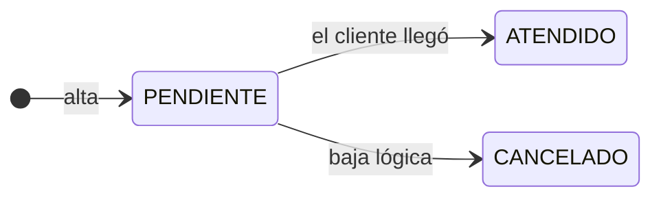
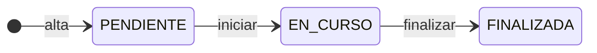
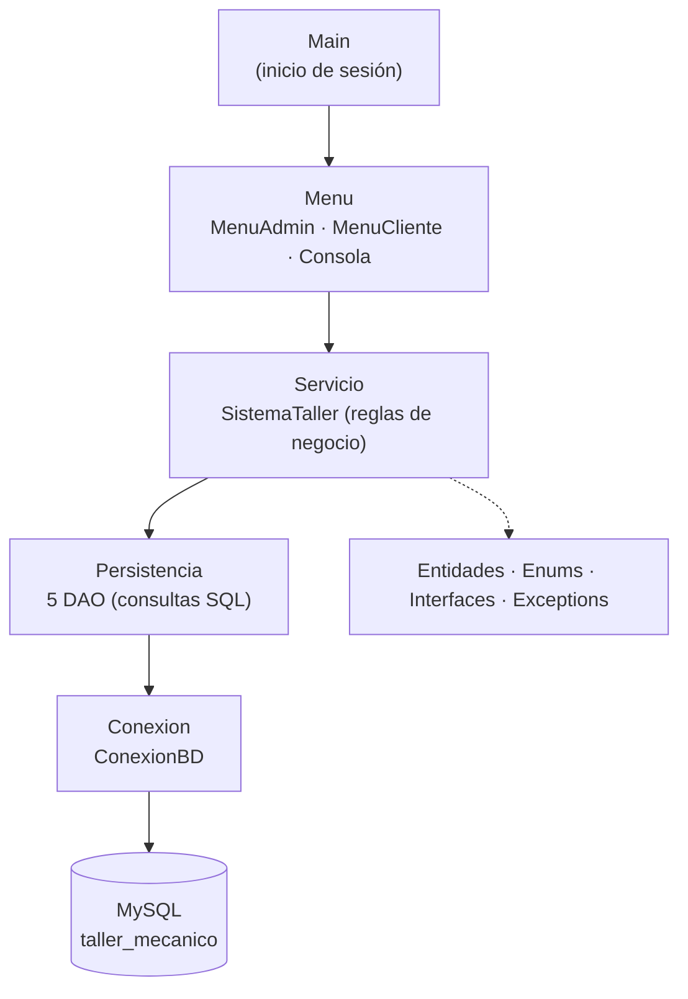
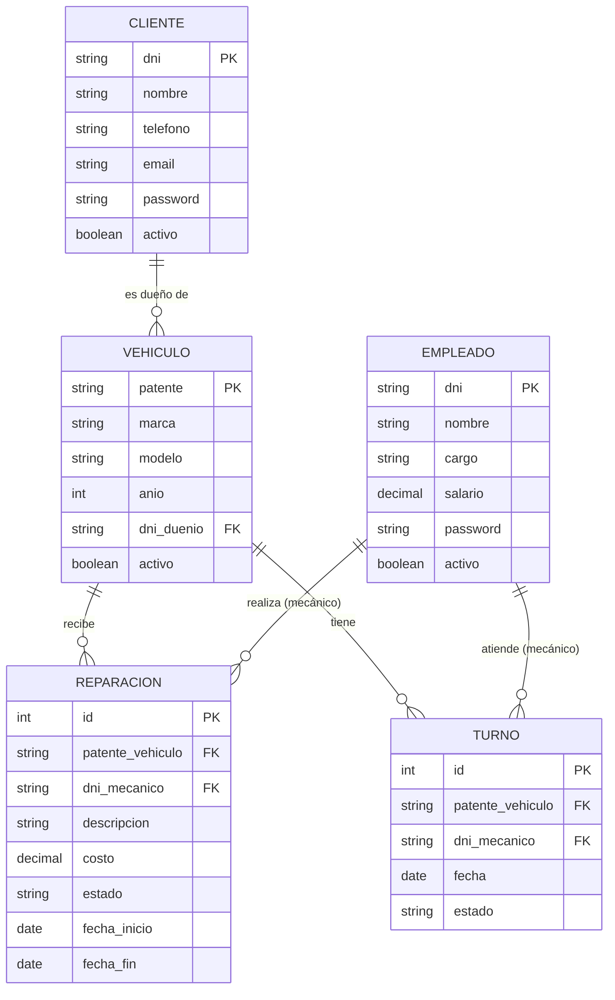

<div align="center">

# 🔧 Sistema de Gestión de Taller Mecánico

**Turnos, reparaciones, clientes y vehículos en un solo sistema**


*Trabajo Práctico Final · Programación II · Comisión 2 · 2026*

</div>

---

## 🚗 ¿De qué se trata?

Un taller mecánico necesita saber **quién es el dueño de cada vehículo, cuándo viene y qué trabajo se le está haciendo**.
Este sistema lo resuelve por consola: se registran clientes, empleados y vehículos, los clientes sacan **turnos**, y el taller
abre y sigue las **reparaciones** hasta que el auto queda listo.

Todo se guarda en una base de datos **MySQL**, así que la información no se pierde al cerrar el programa.

### El recorrido de un vehículo en el taller

```text
  Cliente saca un TURNO  ──►  llega al taller  ──►  se abre una REPARACIÓN  ──►  el auto queda listo
     (PENDIENTE)                 (ATENDIDO)         PENDIENTE → EN_CURSO → FINALIZADA
```

**Turno**



**Reparación**



---

## 👥 Tipos de usuario

| Usuario | Qué puede hacer |
|---|---|
| 🛠️ **Administrador** | Alta, baja, modificación, consulta y listado de **clientes, empleados, vehículos y turnos**. Alta, modificación, inicio y cierre de **reparaciones**. |
| 🙋 **Cliente** | Ver sus datos y sus vehículos, **pedir turnos**, ver y **cancelar** sus turnos y consultar sus reparaciones. Solo ve y toca lo suyo. |

> Los empleados con cargo **mecánico** y **recepcionista** existen en el sistema (se les asignan turnos y reparaciones), pero no tienen menú propio: ingresan al sistema solo los administradores y los clientes.

### Reglas que el taller se encarga de cumplir
- Una persona dada de baja **no puede iniciar sesión** ni sacar turnos.
- El DNI es único: no puede ser cliente y empleado a la vez.
- Un turno necesita una fecha que no sea pasada, un vehículo activo **del propio cliente** y un **mecánico** activo.
- Solo se puede modificar, cancelar o atender un turno **PENDIENTE**.
- Una reparación sigue el orden `PENDIENTE → EN_CURSO → FINALIZADA` y una vez finalizada no se modifica.
- Un vehículo con una reparación sin finalizar **no se puede dar de baja**.
- Nunca se borra nada: las bajas son **lógicas** (se conserva el historial). El único administrador activo no puede darse de baja.

---

## 🧱 Arquitectura

El sistema está dividido en capas: cada una hace una sola cosa y solo habla con la de al lado.




### 📐 Diagramas UML

Están en [`docs/UML`](docs/UML): el archivo editable de **draw.io** ([`UML_Taller_Mecanico.drawio`](docs/UML/UML_Taller_Mecanico.drawio), una pestaña por diagrama),
un [PDF](docs/UML/UML_Taller_Mecanico.pdf) con todos y las imágenes sueltas.

| Diagrama | Imagen |
|---|---|
| UML completo (31 clases) | [`uml-completo.png`](docs/UML/uml-completo.png) |
| Dominio (entidades, enums, interfaz) | [`dominio.png`](docs/UML/dominio.png) |
| Excepciones | [`excepciones.png`](docs/UML/excepciones.png) |
| Persistencia (DAO) | [`persistencia.png`](docs/UML/persistencia.png) |
| Servicio | [`servicio.png`](docs/UML/servicio.png) |
| Menús y Main | [`menus.png`](docs/UML/menus.png) |


---

## 🗄️ Modelo de datos



El script [`database/taller_mecanico.sql`](database/taller_mecanico.sql) crea la base y carga **15 registros en cada tabla**.

---

## ▶️ Cómo ejecutarlo

**Necesitás:** JDK 17 o superior, MySQL 8 e IntelliJ IDEA (o cualquier IDE de Java).

1. **Crear la base de datos.** Ejecutá el script completo en MySQL (Workbench o consola):
   ```bash
   mysql -u root -p < database/taller_mecanico.sql
   ```
   ⚠️ El script borra y vuelve a crear la base `taller_mecanico`.
2. **Configurar la conexión.** En [`src/Conexion/ConexionBD.java`](src/Conexion/ConexionBD.java) poné tu usuario y contraseña de MySQL:
   ```java
   private static final String URL = "jdbc:mysql://localhost:3306/taller_mecanico";
   private static final String USUARIO = "root";
   private static final String PASSWORD = "tu_contraseña";
   ```
3. **Agregar el driver.** En IntelliJ: *File → Project Structure → Modules → Dependencies → `+` → JARs or Directories* y elegí `Lib/mysql-connector-j-26.10.0.jar`.
4. **Ejecutar `Main`** e iniciar sesión.

### 🔑 Usuarios de prueba

| Rol | DNI | Contraseña |
|---|---|---|
| Administrador | `21123456` | `admin123` |
| Cliente | `21931131` | `1234` |
| Cliente dado de baja (no puede ingresar) | `18555666` | `1234` |

Todos los clientes usan la contraseña `1234`.

### 🎬 Demo guiada

[`MainDemo`](src/MainDemo.java) recorre **todos los métodos del sistema y provoca cada excepción** en un orden predefinido, sin escribir nada:
se avanza con **ENTER**. Sirve para ver el sistema completo en pocos minutos.

1. Volver a correr `database/taller_mecanico.sql` (la demo modifica la base).
2. Ejecutar la clase `MainDemo`. Para que corra de corrido: *Edit Configurations → Program arguments:* `--sin-pausas`.

---

<details>
<summary><b>✅ Cumplimiento de la consigna (dónde está cada requisito)</b></summary>

| Requisito del TP | Dónde se cumple |
|---|---|
| Diagrama UML | [`docs/UML`](docs/UML) (draw.io, PDF y PNG) |
| Los 4 pilares de la POO | **Herencia:** `Persona` → `Cliente` y `Empleado`. **Polimorfismo:** `toString()` de `Persona` y `autenticar()`, que devuelve una `Persona` y el `Main` elige el menú. **Abstracción:** `Persona` (clase abstracta) y `Reparable` (interfaz). **Encapsulamiento:** atributos `private`/`protected` y validación en los constructores. |
| Mínimo 5 clases POJO | `Cliente`, `Empleado`, `Vehiculo`, `Reparacion` y `Turno` |
| 1 clase abstracta y 1 interfaz | `Persona` y `Reparable` (implementada por `Reparacion`) |
| Colecciones List, Set y Map (justificadas) | **Map** de clientes y empleados por DNI (búsqueda directa por clave única). **Set** de vehículos (`equals`/`hashCode` por patente: no admite duplicados). **List** de reparaciones y turnos (se repiten por vehículo y importa el orden). La justificación está comentada en `SistemaTaller`. |
| Mínimo 2 excepciones personalizadas | 10: `TallerException` con 8 hijas (checked) y `DatosInvalidosException` (unchecked) |
| JDBC | `ConexionBD` + 5 DAO + `SistemaTaller` |
| Baja lógica | Columna `activo` en cliente, empleado y vehículo; estado `CANCELADO` en turno |
| 15 datos de cada entidad en la base | `database/taller_mecanico.sql` (15 filas por tabla) |
| Código documentado | Javadoc y comentarios de diseño en las clases |
| ABMCL de al menos 4 clases | Clientes, empleados, vehículos y turnos completos. Las reparaciones no tienen baja porque son un registro histórico |
| Dos tipos de acceso | `MenuAdmin` y `MenuCliente` |
| Git y GitHub con todos los integrantes | Ramas `main`, `test-lu` y `test-mica`; commits de ambas integrantes |
| *(Opcional)* Clase genérica / JavaFX | No implementados |

</details>

<details>
<summary><b>🧠 Decisiones de diseño</b></summary>

- **¿Por qué un DAO por entidad?** Cada DAO es la única clase que conoce el SQL de su tabla. Si cambia la base, se toca un solo lugar; `SistemaTaller` no sabe SQL.
- **¿Por qué `SistemaTaller` guarda colecciones en memoria si ya hay base de datos?** Las búsquedas y listados se resuelven sobre memoria. Cada alta, baja o modificación se hace **primero en MySQL** y solo si salió bien se refleja en la colección, así memoria y base nunca quedan distintas.
- **¿Por qué la baja es lógica?** Las reparaciones y los turnos referencian a clientes, vehículos y empleados. Si se borraran, quedarían registros huérfanos (y las claves foráneas lo impedirían). Con `activo = false` se conserva el historial.
- **¿Por qué se modifica creando un objeto nuevo?** Los constructores validan todos los datos juntos. Crear el objeto nuevo y reemplazarlo evita modificaciones a medias y no obliga a tener setters que se salteen las validaciones.
- **¿Por qué los ids de turnos y reparaciones los genera MySQL?** `AUTO_INCREMENT` evita que dos usuarios generen el mismo id. El DAO recupera el id con `LAST_INSERT_ID()` y lo deja en el objeto.
- **¿Por qué `TallerException` como clase base?** Permite que los menús atrapen cualquier error de negocio con un solo `catch`.
- **¿Por qué Vehículo, Reparación y Turno se relacionan por clave?** Guardan `dniDuenio`, `patenteVehiculo` y `dniMecanico`, igual que la base de datos. Así el modelo y las tablas se corresponden uno a uno.

</details>

<details>
<summary><b>📁 Estructura del proyecto</b></summary>

```text
TP-Programacion2-com2/
├── database/
│   └── taller_mecanico.sql        esquema + 15 datos por tabla
├── docs/UML/                      diagramas (draw.io, PDF y PNG)
├── Lib/
│   └── mysql-connector-j-26.10.0.jar
└── src/
    ├── Main.java                  inicio de sesión
    ├── MainDemo.java              demo guiada
    ├── Conexion/    ConexionBD
    ├── Entidades/   Persona (abstracta), Cliente, Empleado, Vehiculo, Reparacion, Turno
    ├── Enums/       Cargo, EstadoReparacion, EstadoTurno
    ├── Exceptions/  TallerException + 8 hijas, DatosInvalidosException
    ├── Interfaces/  Reparable
    ├── Menu/        MenuAdmin, MenuCliente, Consola
    ├── Persistencia/ ClienteDAO, EmpleadoDAO, VehiculoDAO, ReparacionDAO, TurnoDAO
    └── Servicio/    SistemaTaller
```

</details>

<details>
<summary><b>🚧 Limitaciones conocidas y mejoras posibles</b></summary>

- Las contraseñas se guardan en **texto plano**. Una mejora sería guardarlas con un hash.
- Los empleados mecánicos y recepcionistas no tienen menú propio.
- No hay interfaz gráfica (JavaFX) ni clase genérica: eran opcionales.
- La contraseña de MySQL se escribe en `ConexionBD`; en un proyecto real iría en un archivo de configuración.

</details>

---

## 🤝 Trabajo en equipo

El proyecto se desarrolló en equipo con **Git y GitHub**, con una rama de trabajo por integrante (`test-lu` y `test-mica`) que se integra en `main`.

## 👩‍💻 Integrantes

| Integrante | GitHub |
|---|---|
| *(nombre y apellido)* | [@lualcibar](https://github.com/lualcibar) |
| *(nombre y apellido)* | [@MicaCampo](https://github.com/MicaCampo) |

*Universidad Tecnológica Nacional · Facultad Regional Mar del Plata · Programación II · 2026*
