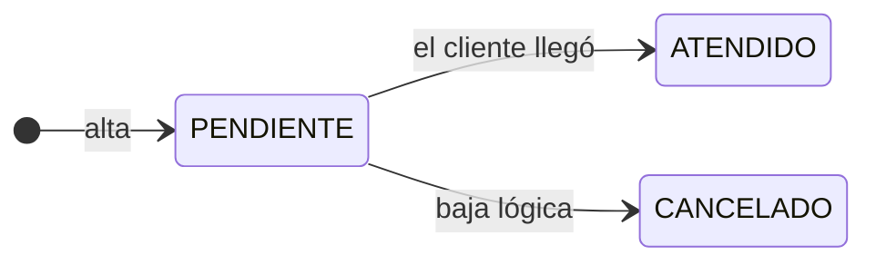
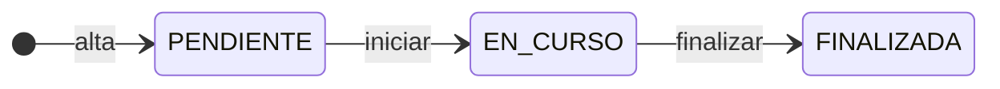
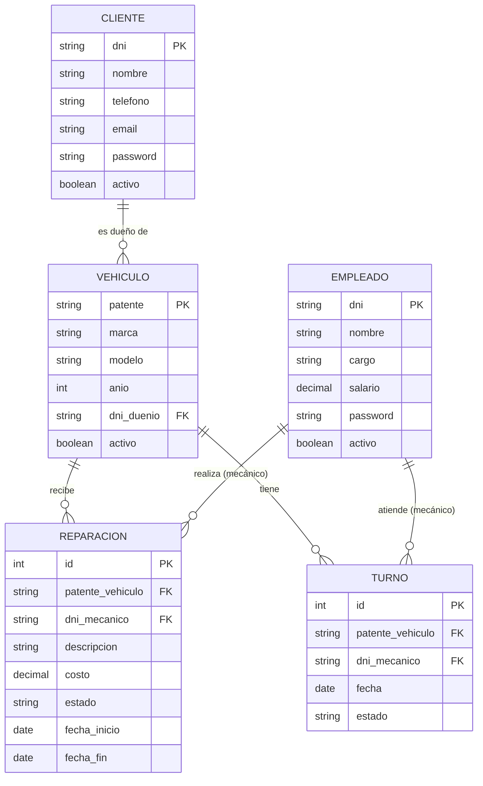

<div align="center">

# Sistema de Gestión de Taller Mecánico

**Turnos, reparaciones, clientes y vehículos en un solo sistema**

*Trabajo Práctico Final · Programación II · Comisión 2 · 2026*

</div>

---

## ¿De qué se trata?


Un taller mecánico necesita saber **quién es el dueño de cada vehículo, cuándo viene y qué trabajo se le está haciendo**.
Este sistema lo resuelve por consola: se registran clientes, empleados y vehículos, los clientes sacan **turnos**, y el taller
abre y sigue las **reparaciones** hasta que el auto queda listo.

Todo se guarda en una base de datos **MySQL**, así que la información no se pierde al cerrar el programa.

### El recorrido de un vehículo en el taller

```text
  Cliente saca un TURNO  ──►  llega al taller  ──►  se abre una REPARACIÓN  ──►  el auto queda listo
     (PENDIENTE)                 (ATENDIDO)         PENDIENTE → EN_CURSO → FINALIZADA
```

**Turno**



**Reparación**



---

## Tipos de usuario

| Usuario | Qué puede hacer |
|---|---|
| **Administrador** | Alta, baja, modificación, consulta y listado de **clientes, empleados, vehículos y turnos**. Alta, modificación, inicio y cierre de **reparaciones**. |
| **Cliente** | Ver sus datos y sus vehículos, **pedir turnos**, ver y **cancelar** sus turnos y consultar sus reparaciones. Solo ve y toca lo suyo. |

> Los empleados con cargo **mecánico** y **recepcionista** existen en el sistema (se les asignan turnos y reparaciones), pero no tienen menú propio: ingresan al sistema solo los administradores y los clientes.

### Reglas que el taller se encarga de cumplir
- Una persona dada de baja **no puede iniciar sesión** ni sacar turnos.
- El DNI es único: no puede ser cliente y empleado a la vez.
- Un turno necesita una fecha que no sea pasada, un vehículo activo **del propio cliente** y un **mecánico** activo.
- Solo se puede modificar, cancelar o atender un turno **PENDIENTE**.
- Una reparación sigue el orden `PENDIENTE → EN_CURSO → FINALIZADA` y una vez finalizada no se modifica.
- Un vehículo con una reparación sin finalizar **no se puede dar de baja**.
- Nunca se borra nada: las bajas son **lógicas** (se conserva el historial). El único administrador activo no puede darse de baja.

---

## Modelo de datos



El script [`database/taller_mecanico.sql`](database/taller_mecanico.sql) crea la base y carga **15 registros en cada tabla**.

----

## Trabajo en equipo

El proyecto se desarrolló en equipo con **Git y GitHub**, con una rama de trabajo por integrante (`test-lu` y `test-mica`) que se integra en `main`.

## Integrantes

| Integrante | GitHub |
|---|---|
| *(Lucia Alcibar)* | [@lualcibar](https://github.com/lualcibar) |
| *(Micaela Campo)* | [@MicaCampo](https://github.com/MicaCampo) |

*Universidad Tecnológica Nacional · Facultad Regional Mar del Plata · Programación II · 2026*
